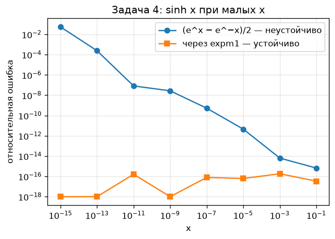
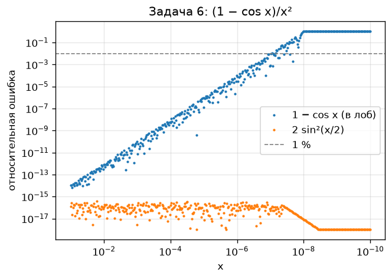
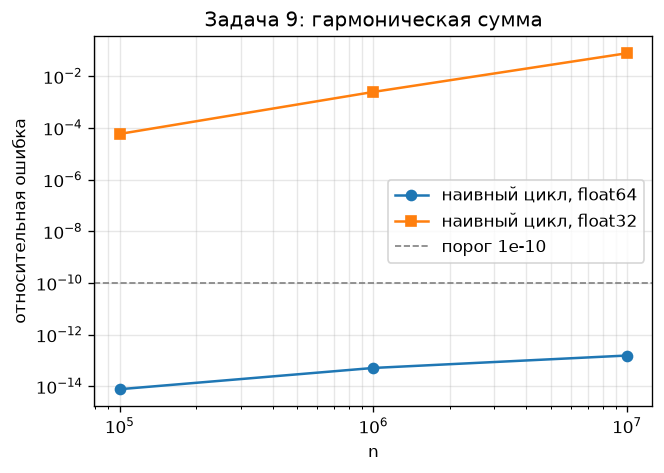
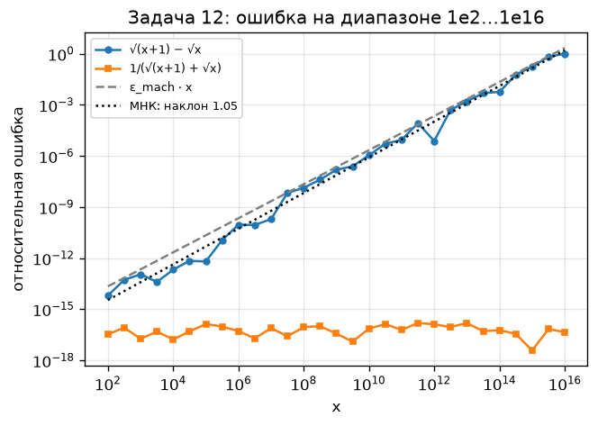
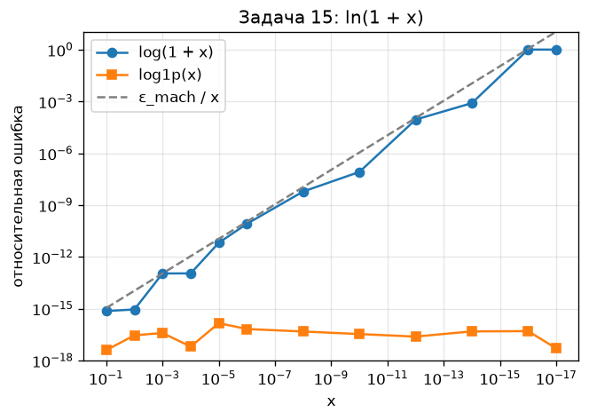

# ДЗ 1. Устойчивость алгоритма и корректная постановка эксперимента

Окружение: Python 3.12.0, numpy 2.5.1, mpmath 1.3.0 (эталон: 50 значащих цифр), ε_mach(float64) = 2.220e-16.

# Блок 1. Обусловленность задачи

## Задача 1. Число обусловленности вручную

cond = |x · f'(x) / f(x)|

| f(x) | точка | формула cond | cond |
|---|---|---|---|
| √x | x = 1e-8 | x·(1/(2√x))/√x = 1/2 | 0.5 |
| ln x | x = 1.001 | x·(1/x)/ln x = 1/ln x | 1000 |
| x − 1 | x = 1.000001 | x/(x − 1) | 1e+06 |
| sin x | x = π/2 | x·cos x / sin x = 0 | 0 |

**Вывод.** По возрастанию: sin x в π/2 (cond = 0) < √x (0.5) < ln x в 1.001 (≈1000) < x − 1 в 1.000001 (≈10⁶). Самая «опасная» — x − 1 около единицы: это вычитание близких чисел, относительная ошибка входа усиливается в миллион раз. ln x около 1 опасен по той же причине (ln x ≈ x − 1). У √x и sin x в π/2 ошибка входа не растёт (у синуса в максимуме даже гасится), это хорошо обусловленные задачи.

## Задача 2. Вычитание близких чисел

f(a, b) = a − b. cond по a: |a · ∂f/∂a / f| = |a / (a − b)|, по b: |b / (a − b)|. При a ≈ b знаменатель → 0, cond → ∞.

| величина | значение |
|---|---|
| a − b (float) | 9.9999999392252903e-09 |
| Δf = f(a+δa,b) − f(a,b) (float) | 1.000000e-09 |
| Δf / δa (float) | 1.0000000827 |
| cond по a = a/(a−b) | 1.00e+08 |
| относит. изменение входа δa/a | 1.00e-09 |
| предсказание: cond · δa/a | 1.00e-01 |
| факт (float): |Δf|/|f| | 1.00e-01 |
| факт (mpmath, точно) | 1.00e-01 |
| ошибка самого a − b в float (отн.) | 6.08e-09 |

**Вывод.** Изменение входа на 10⁻⁹ (относительно) дало изменение результата на 10⁻¹ — ровно в cond ≈ 10⁸ раз, предсказание совпадает с фактом. Δf/δa ≈ 1, т.е. абсолютная чувствительность нормальная, а плохой делает задачу деление на маленький результат a − b. Заодно видно, что уже округление a = 1 + 10⁻⁸ до double (ошибка ~10⁻¹⁶) даёт ошибку разности ~10⁻⁸ — тот же множитель 10⁸.

## Задача 3. Кратный корень

x² − 2x + (1 − ε) = 0, точные корни 1 ± √ε.

| ε | корень x₁ | сдвиг |x₁ − 1| | сдвиг / ε | отношение сдвигов (пред./тек.) |
|---|---|---|---|---|
| 1e-2 | 1.100000000000 | 1.00e-01 | 10 | — |
| 1e-4 | 1.010000000000 | 1.00e-02 | 100 | 10 |
| 1e-6 | 1.001000000000 | 1.00e-03 | 1000 | 10 |

**Вывод.** Сдвиг корня равен √ε: при уменьшении возмущения в 100 раз корень сдвигается всего в 10 раз меньше. Отношение «сдвиг / ε» = 1/√ε растёт неограниченно (10, 100, 1000), т.е. у двукратного корня число обусловленности бесконечно. Для корня кратности m сдвиг ~ ε^(1/m): чем выше кратность, тем хуже обусловленность. Это свойство задачи, а не алгоритма — точный корень сдвигается так же.

## Задача 4. Обусловленность vs устойчивость

Пример: f(x) = sinh x при малых x. cond = |x · cosh x / sinh x| ≈ 1 при x → 0 — задача обусловлена отлично.

- неустойчивый алгоритм: (eˣ − e⁻ˣ)/2 — вычитание двух близких к 1 чисел;
- устойчивый: (expm1(x) − expm1(−x))/2 — expm1 точно считает eˣ − 1, а слагаемые разного знака, сокращения нет.

| x | cond задачи | ошибка (eˣ − e⁻ˣ)/2 | ошибка через expm1 |
|---|---|---|---|
| 1.00e-01 | 1.003331 | 6.59e-16 | 3.36e-17 |
| 1.00e-03 | 1.000000 | 6.32e-15 | 1.81e-16 |
| 1.00e-05 | 1.000000 | 4.56e-12 | 6.18e-17 |
| 1.00e-07 | 1.000000 | 5.26e-10 | 7.85e-17 |
| 1.00e-09 | 1.000000 | 2.72e-08 | 1.67e-19 |
| 1.00e-11 | 1.000000 | 8.27e-08 | 1.62e-16 |
| 1.00e-13 | 1.000000 | 2.44e-04 | 1.67e-27 |
| 1.00e-15 | 1.000000 | 5.47e-02 | 1.67e-31 |

**Вывод.** **Проблема задачи:** её нет — cond ≈ 1 на всём диапазоне, малая ошибка входа даёт такую же малую ошибку выхода. **Проблема алгоритма:** формула через eˣ и e⁻ˣ вычитает два числа ≈ 1, каждое уже округлено с ошибкой ~10⁻¹⁶, и после сокращения относительная ошибка становится ~10⁻¹⁶/x (при x = 10⁻¹⁵ — уже ~5%). Вариант через expm1 даёт машинную точность на всех x.

# Блок 2. Устойчивость алгоритма

## Задача 5. Квадратное уравнение

a = 1, c = 1, меньший по модулю корень x₂.

| b | x₂ плохо | x₂ хорошо | эталон | ошибка плохого | ошибка хорошего |
|---|---|---|---|---|---|
| 1.00e+04 | -1.000000e-04 | -1.000000e-04 | -0.000100000001 | 1.12e-09 | 5.65e-17 |
| 1.00e+08 | -7.450581e-09 | -1.000000e-08 | -1.0e-8 | 2.55e-01 | 7.91e-17 |
| 1.00e+12 | 0.000000e+00 | -1.000000e-12 | -1.0e-12 | 1.00e+00 | 2.01e-17 |

**Вывод.** Ошибка плохой формулы растёт примерно как ε_mach · b²: при b = 10⁴ уже ~10⁻⁹ (потеряно 7 знаков из 16), при b = 10⁸ — 25% (√(b² − 4) отличается от b лишь в последнем бите), при b = 10¹² b² − 4 == b² в double, −b + b = 0 и ошибка 100%. Катастрофическая ошибка начинается, когда 4ac/b² сравнимо с ε_mach, т.е. при b ≳ 2/√ε_mach ≈ 10⁸. Хорошая формула не вычитает близкие числа и даёт машинную точность при всех b.

## Задача 6. (1 − cos x) / x² при малых x

| x | плохо | хорошо | эталон | ошибка плохого | ошибка хорошего |
|---|---|---|---|---|---|
| 1.00e-02 | 0.4999958333 | 0.4999958333 | 0.499995833347 | 2.88e-13 | 1.14e-16 |
| 1.00e-04 | 0.499999997 | 0.4999999996 | 0.499999999583 | 5.24e-09 | 1.53e-16 |
| 1.00e-06 | 0.5000444503 | 0.5 | 0.5 | 8.89e-05 | 4.44e-17 |
| 1.00e-08 | 0 | 0.5 | 0.5 | 1.00e+00 | 8.33e-18 |
| 1.00e-10 | 0 | 0.5 | 0.5 | 1.00e+00 | 8.33e-22 |

На сетке из 400 точек ошибка плохого способа впервые превышает 1% при x ≈ 9.49e-08 (оценка: ε_mach / x² = 0.01 → x ≈ √(ε_mach/0.01) ≈ 1.5e-07).

**Вывод.** Ошибка плохого способа растёт как ε_mach/x², превышает 1% около x ≈ 9e-08, а при x ≤ 10⁻⁸ cos x округляется ровно в 1 и результат 0 (ошибка 100%). Через 2·sin²(x/2) ошибка остаётся ~10⁻¹⁶. Правило: если в формуле из функции, близкой к константе, вычитается эта константа (1 − cos x, cos a − cos b, sin a − sin b, 1 − cos² …), надо искать тождество, которое превращает разность в произведение.

## Задача 7. √(x+1) − √x при больших x

| x | плохо | хорошо | эталон | ошибка плохого | ошибка хорошего |
|---|---|---|---|---|---|
| 1.00e+04 | 4.9998750062e-03 | 4.9998750062e-03 | 0.00499987500625 | 2.13e-13 | 1.73e-17 |
| 1.00e+08 | 5.0000000556e-05 | 4.9999999875e-05 | 4.9999999875e-5 | 1.36e-08 | 9.01e-17 |
| 1.00e+12 | 5.0000380725e-07 | 5.0000000000e-07 | 5.0e-7 | 7.61e-06 | 1.32e-16 |
| 1.00e+14 | 5.0291419029e-08 | 5.0000000000e-08 | 5.0e-8 | 5.83e-03 | 5.99e-17 |
| 1.00e+16 | 0.0000000000e+00 | 5.0000000000e-09 | 5.0e-9 | 1.00e+00 | 4.59e-17 |

Наклон log(ошибки) от log(x) по точкам 1e4…1e14: **0.99**.

**Вывод.** Ошибка плохого способа растёт примерно как x¹ (оценённый показатель 0.99): √(x+1) и √x совпадают в первых ~log₁₀(x)/2 знаках, и каждое удвоение порядка x съедает ещё порядок точности. При x = 10¹⁶ x + 1 == x в double, ответ 0 и ошибка 100%. Домножение на сопряжённое убирает вычитание, ошибка остаётся ~10⁻¹⁶ при любом x.

## Задача 8. ln(1 + x) при малых x

| x | log(1+x) | log1p(x) | эталон | ошибка log | ошибка log1p |
|---|---|---|---|---|---|
| 1.00e-02 | 9.950330853168e-03 | 9.950330853168e-03 | 0.00995033085317 | 9.01e-16 | 2.89e-17 |
| 1.00e-08 | 9.999999889225e-09 | 9.999999950000e-09 | 9.99999995e-9 | 6.08e-09 | 4.78e-17 |
| 1.00e-12 | 1.000088900582e-12 | 9.999999999995e-13 | 9.99999999999e-13 | 8.89e-05 | 2.42e-17 |
| 1.00e-16 | 0.000000000000e+00 | 1.000000000000e-16 | 1.0e-16 | 1.00e+00 | 5.00e-17 |

**Вывод.** Проблема не в логарифме, а в сложении 1 + x: при x = 10⁻¹⁶ сумма округляется до 1 и ln даёт 0, при x = 10⁻¹² теряется ~4 знака из 16. В документации Python про math.log1p сказано: «calculated in a way which is accurate for x near zero» — функция получает x напрямую и не формирует 1 + x (вызывается log1p из C-библиотеки libm: ряд при малых x или поправка к ln(1 + x) на ошибку округления суммы), поэтому малая часть не теряется. Отсюда и «странные» функции стандартной библиотеки: log1p, expm1 (eˣ − 1), hypot (√(x²+y²) без переполнения x²) — это готовые устойчивые алгоритмы для типичных опасных формул.

## Задача 9. Накопление ошибки в сумме Σ 1/k

Python 3.12.0. Начиная с 3.12 встроенная `sum()` для float использует компенсированное суммирование (Неймайер), поэтому сравниваем её отдельно от наивного цикла.

| n | эталон Sₙ | наивный цикл | sum(arr) | math.fsum(arr) |
|---|---|---|---|---|
| 1e5 | 12.090146129863428 | 7.69e-15 | 4.49e-17 | 4.49e-17 |
| 1e6 | 14.392726722865724 | 5.10e-14 | 4.63e-17 | 4.63e-17 |
| 1e7 | 16.695311365859852 | 1.55e-13 | 4.32e-17 | 4.32e-17 |

Наклон ошибки наивного цикла: ≈ n^0.65. Экстраполяция до ошибки 10⁻¹⁰: n ≈ 2.1e+11.

Для наглядности тот же наивный цикл в float32:

| n | сумма float32 | ошибка |
|---|---|---|
| 1e5 | 12.090851 | 5.83e-05 |
| 1e6 | 14.357358 | 2.46e-03 |
| 1e7 | 15.403683 | 7.74e-02 |

**Вывод.** У наивного цикла в float64 ошибка растёт примерно как n^0.65 и на n ≤ 10⁷ остаётся ~10⁻¹⁴ — порог 10⁻¹⁰ при этих n не достигается (по экстраполяции — около n ~ 2e+11, т.е. практически только для огромных массивов). Однако ошибка растёт систематически: каждое маленькое 1/k прибавляется к большой сумме и теряет младшие биты. В float32 тот же цикл уже при n = 10⁵ ошибается в ~4-м знаке, а дальше сумма вообще перестаёт расти. sum() в Python 3.12+ и fsum дают точность ~10⁻¹⁶ — наивный цикл для больших массивов использовать не стоит.

# Блок 3. Корректная постановка эксперимента

## Задача 10. Разделение источников ошибки

Функция из задачи 6: (1 − cos x)/x².

**(а) меняем x, алгоритм плохой, float64:**

| x | ошибка |
|---|---|
| 1.00e-01 | 1.11e-14 |
| 1.00e-03 | 1.57e-11 |
| 1.00e-05 | 8.27e-08 |
| 1.00e-07 | 7.99e-04 |

**(б) x = 0.01, алгоритм плохой, меняем тип:**

| тип | ошибка |
|---|---|
| float64 | 2.88e-13 |
| float32 | 1.74e-04 |

**(в) x = 0.01, float64, меняем алгоритм:**

| алгоритм | ошибка |
|---|---|
| плохой | 2.88e-13 |
| хороший | 1.14e-16 |

**Сводка:**

| фактор | что меняли | ошибка: было → стало | порядков |
|---|---|---|---|
| сокращение (x) | x: 1e-1 → 1e-7 | 1.11e-14 → 7.99e-04 | 10.9 |
| машинная точность | float64 → float32 (x=1e-2) | 2.88e-13 → 1.74e-04 | 8.8 |
| устойчивость алгоритма | плохой → хороший (x=1e-2) | 2.88e-13 → 1.14e-16 | 3.4 |
| устойчивость алгоритма | плохой → хороший (x=1e-7) | 7.99e-04 → 5.62e-17 | 13.2 |

**Вывод.** (а) При уменьшении x на 6 порядков ошибка плохого алгоритма выросла на ~11 порядков (закон ε/x²) — доминирует сокращение при вычитании 1 − cos x. (б) При фиксированном x = 0.01 переход на float32 добавил ~9 порядков: механизм тот же, но ε ≈ 6·10⁻⁸ вместо 1.1·10⁻¹⁶ — здесь доминирует машинная точность. (в) Смена алгоритма при x = 0.01 убирает ~3 порядка, а при x = 10⁻⁷ — ~13: чем сильнее сокращение, тем важнее устойчивость. Сама задача хорошо обусловлена (cond ≈ x²/6 → 0), т.е. вся эта ошибка — вклад алгоритма и точности типа, а не задачи.

## Задача 11. Эталон обязателен

Два разных алгоритма для (1 − cos x)/x² при x = 10⁻⁸:

- A: `(1 - math.cos(x)) / x**2` (скалярно, модуль math);
- B: `np.float64(1) - np.cos(x)` и деление на `x*x` (numpy).

|  | значение |
|---|---|
| A | 0.0 |
| B | 0.0 |
| A == B | True |
| эталон mpmath | 0.5 |
| ошибка A | 1.00e+00 |
| ошибка B | 1.00e+00 |

Ещё пример: сумма 0.1 десять раз — циклом и через functools.reduce:

|  | значение |
|---|---|
| цикл | 0.9999999999999999 |
| reduce | 0.9999999999999999 |
| цикл == reduce | True |
| цикл == 1.0 | False |
| math.fsum | 1.0 |

**Вывод.** Оба алгоритма дают 0.0 и совпадают через ==, но правильный ответ 0.5 — ошибка 100%. Совпадение двух float-результатов говорит лишь о том, что они повторяют одну и ту же ошибку (одинаковое округление cos x до 1, одинаковый порядок сложений). Проверять можно только относительно независимого эталона с заведомо большей точностью (mpmath, decimal, аналитический ответ).

## Задача 12. Диапазон, а не одна точка

| x | ошибка плохого | ошибка хорошего | ε_mach · x |
|---|---|---|---|
| 1.00e+02 | 6.50e-15 | 3.45e-17 | 2.22e-14 |
| 3.16e+02 | 5.34e-14 | 8.34e-17 | 7.02e-14 |
| 1.00e+03 | 1.14e-13 | 1.87e-17 | 2.22e-13 |
| 3.16e+03 | 4.02e-14 | 4.89e-17 | 7.02e-13 |
| 1.00e+04 | 2.13e-13 | 1.73e-17 | 2.22e-12 |
| 3.16e+04 | 6.99e-13 | 4.97e-17 | 7.02e-12 |
| 1.00e+05 | 6.42e-13 | 1.38e-16 | 2.22e-11 |
| 3.16e+05 | 1.17e-11 | 9.67e-17 | 7.02e-11 |
| 1.00e+06 | 9.26e-11 | 5.26e-17 | 2.22e-10 |
| 3.16e+06 | 8.93e-11 | 1.97e-17 | 7.02e-10 |
| 1.00e+07 | 1.98e-10 | 7.86e-17 | 2.22e-09 |
| 3.16e+07 | 6.81e-09 | 2.61e-17 | 7.02e-09 |
| 1.00e+08 | 1.36e-08 | 9.01e-17 | 2.22e-08 |
| 3.16e+08 | 4.10e-08 | 1.02e-16 | 7.02e-08 |
| 1.00e+09 | 1.56e-07 | 3.74e-17 | 2.22e-07 |
| 3.16e+09 | 2.50e-07 | 1.27e-17 | 7.02e-07 |
| 1.00e+10 | 1.12e-06 | 7.38e-17 | 2.22e-06 |
| 3.16e+10 | 5.22e-06 | 1.35e-16 | 7.02e-06 |
| 1.00e+11 | 8.90e-06 | 6.16e-17 | 2.22e-05 |
| 3.16e+11 | 8.54e-05 | 1.58e-16 | 7.02e-05 |
| 1.00e+12 | 7.61e-06 | 1.32e-16 | 2.22e-04 |
| 3.16e+12 | 5.12e-04 | 9.06e-17 | 7.02e-04 |
| 1.00e+13 | 1.61e-03 | 1.56e-16 | 2.22e-03 |
| 3.16e+13 | 4.93e-03 | 5.20e-17 | 7.02e-03 |
| 1.00e+14 | 5.83e-03 | 5.99e-17 | 2.22e-02 |
| 3.16e+14 | 5.99e-02 | 3.61e-17 | 7.02e-02 |
| 1.00e+15 | 1.78e-01 | 3.81e-18 | 2.22e-01 |
| 3.16e+15 | 6.76e-01 | 6.91e-17 | 7.02e-01 |
| 1.00e+16 | 1.00e+00 | 4.59e-17 | 2.22e+00 |

Наклон по точкам 1e2…1e15 (МНК в log-log): **1.05**, коэффициент 10^-16.55 ≈ 2.8e-17 (у ε_mach — 2.2e-16).

**Вывод.** Наклон ≈ 1.05 совпадает с предсказанием «ошибка ≈ ε_mach · x» (наклон 1); отдельные точки скачут на порядок вверх-вниз (от того, как удачно округлились √(x+1) и √x), а у x ≈ 10¹⁶ ошибка насыщается на 100%. По одной точке нельзя было бы отличить «повезло с округлением» от закономерности и нельзя оценить скорость роста; диапазон на логарифмической сетке показывает закон, границу применимости и место, где метод ломается полностью.

## Задача 13. Воспроизводимость

Python 3.12.0, numpy 2.5.1, mpmath 1.3.0, ОС Windows 11.

| генератор | способ | seed 42: запуск 1 == запуск 2 | ошибка (seed 42) | ошибка (seed 43) |
|---|---|---|---|---|
| random | наивный цикл | True | 1.17e-14 | 3.90e-14 |
| random | sum | True | 1.98e-17 | 2.21e-17 |
| random | math.fsum | True | 1.98e-17 | 2.21e-17 |
| random | numpy.sum | True | 2.02e-16 | 1.01e-15 |
| numpy | наивный цикл | True | 1.72e-13 | 6.15e-14 |
| numpy | sum | True | 6.93e-17 | 4.63e-17 |
| numpy | math.fsum | True | 6.93e-17 | 4.63e-17 |
| numpy | numpy.sum | True | 1.52e-15 | 3.98e-16 |

Числа: значения вида U(−1,1)·10^k, k ∈ [−8, 8], 10⁵ штук, эталон — mpmath.fsum.

**Вывод.** При одном seed результаты всех способов совпадают бит в бит, т.е. эксперимент воспроизводим. При seed = 43 конкретные ошибки другие, но картина та же: fsum и sum (Python ≥ 3.12) точны до последнего бита, numpy.sum (попарное суммирование) на 1–2 порядка точнее наивного цикла, наивный цикл — худший. Значит разница между способами систематическая (следствие алгоритма), а не случайная. Без фиксации seed, версии Python (в 3.11 sum ещё наивная!) и версии numpy (меняются алгоритмы суммирования и SIMD) тот же код может дать другие числа и другой вывод.

## Задача 14. Границы представимости

| массив | наивная сумма | math.fsum |
|---|---|---|
| [1e300]×1000 | 9.99999999999988e+302 | 1e+303 |
| [1e300, 1, −1e300] | 0.0 | 1.0 |
| [1e-300]×10 | 1e-299 | 1e-299 |
| [1e-320, 1e-320] | 2e-320 | 2e-320 |
| [1e-320, 1.0, −1.0] | 0.0 | 1e-320 |
| все виды без inf/nan | 0.0 | 1e-300 |
| + inf | inf | inf |
| inf и −inf | nan | ValueError: -inf + inf in fsum |
| + nan (в начале) | nan | nan |
| + nan (в конце) | nan | nan |
| 1e308 + 1e308 − 1e308 | inf | OverflowError: intermediate overflow in fsum |

Наименьшее нормализованное: 2.225e-308; 1e-320 — денормализованное, 1e-320 == 0: False, 1e-320/2 = 5e-321.

**Вывод.** NaN «отравляет» оба способа: наивная сумма становится nan сразу при встрече и уже не восстанавливается; fsum тоже возвращает nan. inf ведёт себя как обычная бесконечность (сумма = inf), но inf + (−inf) у наивного способа даёт nan, а fsum выбрасывает ValueError, т.е. явно сообщает о проблеме. Переполнение промежуточной суммы: в 1e308 + 1e308 − 1e308 наивный цикл получает inf и уже не может вернуться, хотя ответ 1e308 представим; fsum выдаёт OverflowError «intermediate overflow». На [1e300]×1000 переполнения нет, но наивная сумма теряет младшие знаки, fsum точна. С [1e300, 1, −1e300] и [1e-320, 1, −1] наивная сумма теряет малое слагаемое (0.0), fsum возвращает его точно. Денормализованные числа складываются корректно, но с потерей точности. В реальном коде: заранее проверять math.isfinite / np.isnan и решать, что делать с такими значениями; масштабировать данные, чтобы не переполняться; для точных сумм использовать fsum и ловить его исключения.

## Задача 15. Полный корректный эксперимент

**Цель.** Исследовать устойчивость вычисления f(x) = ln(1 + x) при малых x (функция из задачи 8) и определить, где наивный алгоритм ещё пригоден.

**Постановка.** Плохой алгоритм: `math.log(1 + x)`. Хороший: `math.log1p(x)`. Задача хорошо обусловлена: cond = x / ((1 + x)·ln(1 + x)) → 1 при x → 0. Вход — 12 точек логарифмической сетки от 10⁻¹ до 10⁻¹⁷ (шаг 1 порядок до 10⁻⁶, дальше 2 порядка, и 10⁻¹⁷ как точка за границей ε_mach), float64.

**Эталон.** `mpmath.log1p` с 50 значащими цифрами, вычисляемый от того же double-значения x (т.е. эталон точно соответствует входу, ошибки входа нет).

**Результаты.**

| x | плохой | хороший | эталон | ошибка плохого | ошибка хорошего |
|---|---|---|---|---|---|
| 1.00e-01 | 9.531017980432493e-02 | 9.531017980432487e-02 | 0.09531017980432487 | 7.32e-16 | 4.00e-18 |
| 1.00e-02 | 9.950330853168092e-03 | 9.950330853168083e-03 | 0.009950330853168083 | 9.01e-16 | 2.89e-17 |
| 1.00e-03 | 9.995003330834232e-04 | 9.995003330835331e-04 | 0.0009995003330835332 | 1.10e-13 | 3.90e-17 |
| 1.00e-04 | 9.999500033329732e-05 | 9.999500033330834e-05 | 9.999500033330834e-5 | 1.10e-13 | 6.37e-18 |
| 1.00e-05 | 9.999950000398841e-06 | 9.999950000333330e-06 | 9.999950000333332e-6 | 6.55e-12 | 1.46e-16 |
| 1.00e-06 | 9.999994999180668e-07 | 9.999995000003334e-07 | 9.999995000003333e-7 | 8.23e-11 | 6.65e-17 |
| 1.00e-08 | 9.999999889225291e-09 | 9.999999950000001e-09 | 9.999999950000001e-9 | 6.08e-09 | 4.78e-17 |
| 1.00e-10 | 1.000000082690371e-10 | 9.999999999500001e-11 | 9.9999999995e-11 | 8.27e-08 | 3.39e-17 |
| 1.00e-12 | 1.000088900581841e-12 | 9.999999999995000e-13 | 9.999999999995e-13 | 8.89e-05 | 2.42e-17 |
| 1.00e-14 | 9.992007221626358e-15 | 9.999999999999950e-15 | 9.99999999999995e-15 | 7.99e-04 | 4.87e-17 |
| 1.00e-16 | 0.000000000000000e+00 | 1.000000000000000e-16 | 9.999999999999999e-17 | 1.00e+00 | 5.00e-17 |
| 1.00e-17 | 0.000000000000000e+00 | 1.000000000000000e-17 | 1.0e-17 | 1.00e+00 | 5.00e-18 |

Плохой алгоритм даёт ошибку < 10⁻⁶ при x ≥ 1e-10; максимальная ошибка хорошего на всём диапазоне: 1.5e-16.

**Вывод.** Неустойчивость не в логарифме, а в операции 1 + x: она округляет x до шага сетки double около 1 (≈1.1·10⁻¹⁶), относительная ошибка этого округления ~ε_mach/x, и логарифм её сохраняет. Поэтому ошибка плохого алгоритма идёт вдоль прямой ε_mach/x: 10⁻¹⁵ при x = 0.1, 10⁻¹⁰ при x = 10⁻⁶, 10⁻⁴ при x = 10⁻¹², 100% при x ≤ 10⁻¹⁶. Пригоден он, если нужная точность δ больше ε_mach/x, т.е. при x ≳ ε_mach/δ (для 6 верных знаков — при x ≳ 10⁻¹⁰). log1p получает x целиком и даёт машинную точность (~10⁻¹⁶) на всём диапазоне — это и есть достижимая точность, так как задача обусловлена с cond ≈ 1.
