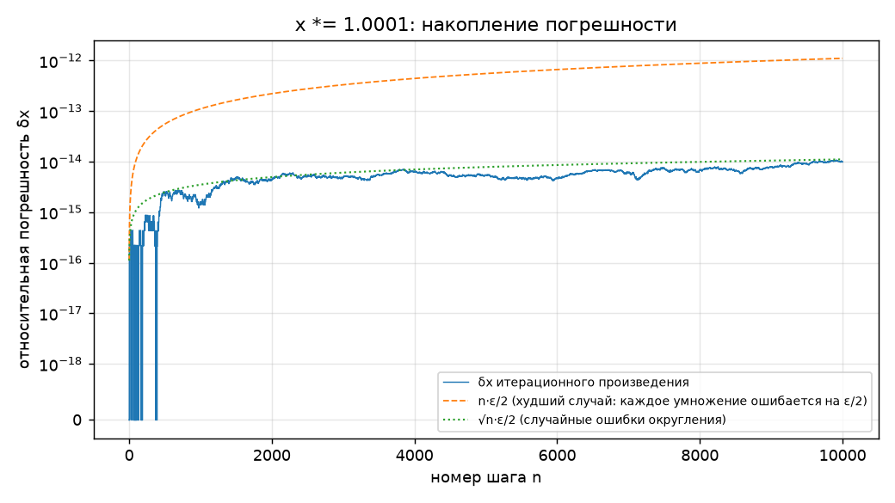

# ДЗ 2. Абсолютная и относительная погрешность. Округление и накопление ошибки

Python 3.12.0, NumPy 2.5.1, mpmath 1.3.0, машинный эпсилон ε = 2.220e-16.

Отчёт собран автоматически скриптом `dz2.py`.

# Блок 1. Абсолютная и относительная погрешность

## Задача 2. Сравнение несопоставимых величин

| объект | x | x* | Δx | δx |
|---|---|---|---|---|
| мост | 1247 м | 1250 м | 3 м | 0.24 % |
| болт | 9.7 мм | 10.0 мм | 0.3 мм | 3.00 % |

**Вывод.** По Δx «сильнее» ошибся мостостроитель (3 м против 0.3 мм — в 10 000 раз больше), но по δx — измеритель болта: 3 % против 0.24 %, то есть в 12.5 раза хуже. Абсолютные погрешности в разных единицах и масштабах вообще нельзя сравнивать, а относительная безразмерна и показывает, насколько ошибка существенна для самого объекта, поэтому правильный ответ: сильнее ошибся тот, кто мерил болт.

## Задача 1. Ручной счёт

| пара | Δx | δx |
|---|---|---|
| x = 3.14, x* = π | 0.001593 | 0.0507 % |
| x = 2.718, x* = e | 0.000282 | 0.0104 % |
| x = 9.8, x* = 9.81 | 0.010000 | 0.1019 % |
| x = 0.333, x* = 1/3 | 0.000333 | 0.1000 % |

Порядок от лучшего к худшему:

- по Δx: `x* = e` → `x* = 1/3` → `x* = π` → `x* = 9.81`
- по δx: `x* = e` → `x* = π` → `x* = 1/3` → `x* = 9.81`

**Вывод.** Лучшее приближение — 2.718 для e, худшее — 9.8 для g, но в середине порядок разный: по Δx 0.333 точнее, чем 3.14 (0.00033 против 0.0016), а по δx наоборот (0.10 % против 0.05 %). Абсолютная ошибка не учитывает масштаб числа: 0.00033 для величины порядка 0.3 — это столько же «в долях», сколько 0.003 для величины порядка 3, поэтому качество сравнивают по δx.

## Задача 3. Функция relative_error

```python
def relative_error(approx, exact):
    if exact == 0:
        return float('inf')
    return abs(approx - exact) / abs(exact)
```

| пара | relative_error |
|---|---|
| x = 3.14, x* = π | 5.069574e-04 |
| x = 2.718, x* = e | 1.036789e-04 |
| x = 9.8, x* = 9.81 | 1.019368e-03 |
| x = 0.333, x* = 1/3 | 1.000000e-03 |
| x = 0.5, x* = 0 (защита) | inf |
| x = 0, x* = 0 (защита) | inf |

**Вывод.** Функция дала те же δx, что и в задаче 1, а при exact = 0 вернула inf вместо ZeroDivisionError. Это честный ответ: относительная погрешность для нулевого точного значения не определена, в таком случае нужно смотреть на абсолютную погрешность.

## Задача 4. Обратная задача — оценка точного значения

Строго: |x − x*| ≤ 0.001·x*  ⇒  x/1.001 ≤ x* ≤ x/0.999  ⇒  x* ∈ [47.2527; 47.3473].

Приближённо (Δ ≈ δ·x = 0.0473): x* ∈ [47.2527; 47.3473].

**Ответ:** x* ∈ [47.25; 47.35], то есть x* = 47.30 ± 0.05.

**Вывод.** Относительная погрешность 0.1 % для числа ≈ 47 даёт абсолютную ≈ 0.047, поэтому достоверны только сотые доли и ответ разумно записать с четырьмя значащими цифрами. Строгий и приближённый интервалы совпадают до 4-го знака после запятой, так что при малых δ можно считать Δ ≈ δ·x.

## Задача 5. Порог по абсолютной и относительной ошибке

|T| · 0.005 ≤ 0.3  ⇒  |T| ≤ 60 °C.

| T | Δ датчика A | Δ датчика B | точнее |
|---|---|---|---|
| -80 °C | 0.3 | 0.400 | A |
| -60 °C | 0.3 | 0.300 | одинаково |
| -20 °C | 0.3 | 0.100 | B |
| 0 °C | 0.3 | 0.000 | B |
| 20 °C | 0.3 | 0.100 | B |
| 36.6 °C | 0.3 | 0.183 | B |
| 60 °C | 0.3 | 0.300 | одинаково |
| 100 °C | 0.3 | 0.500 | A |
| 300 °C | 0.3 | 1.500 | A |

**Вывод.** Датчик B не хуже A при |T| ≤ 60 °C (на границе погрешности равны 0.3 °C), а при |T| > 60 °C выигрывает A. У A ошибка постоянная, а у B растёт пропорционально измеряемой величине, поэтому для комнатных и уличных температур выгоднее B, а для печи или духовки — A.

# Блок 2. Значащие цифры и округление

## Задача 6. Подсчёт значащих цифр

| число | значащих цифр | экспоненциальная запись |
|---|---|---|
| 0.004520 | 4 (4, 5, 2, 0; ведущие нули не значащие, хвостовой 0 после запятой — значащий) | 4.520·10⁻³ |
| 1200 | неоднозначно: 2, 3 или 4 | 1.2·10³ / 1.20·10³ / 1.200·10³ |
| 1.200 | 4 | 1.200·10⁰ |
| 10.03 | 4 (нули между ненулевыми цифрами значащие) | 1.003·10¹ |
| 0.03050 | 4 (3, 0, 5, 0) | 3.050·10⁻² |
| 250000 | неоднозначно: от 2 до 6 | 2.5·10⁵ … 2.50000·10⁵ |

**Вывод.** Неоднозначны только целые числа с нулями на конце (1200 и 250000): по такой записи не понятно, измерены эти нули или просто стоят как «заполнители разряда». В десятичных дробях хвостовые нули после запятой сами по себе сообщают точность, а экспоненциальная форма снимает неоднозначность всегда — в мантиссе пишем ровно столько цифр, сколько верных.

## Задача 7. Честная запись результата

Погрешность 0.02 сидит в разряде сотых ⇒ округляем x до сотых: 4.738291 → 4.74.

**Ответ:** x = 4.74 ± 0.02 — осталось 3 значащие цифры.

**Вывод.** Запись 4.738291 ± 0.02 противоречива: цифры 8, 2, 9, 1 стоят в разрядах, которые меньше самой погрешности, то есть они случайны и создают ложное впечатление точности до миллионных. Результат нельзя записывать точнее, чем позволяет его погрешность.

## Задача 8. Округление и banker's rounding

```
print(round(0.5), round(1.5), round(2.5), round(3.5), round(-0.5), round(-1.5), round(-2.5))
0 2 2 4 0 -2 -2
```

| способ | сумма округлённых | сдвиг от точной суммы | сдвиг на одно число |
|---|---|---|---|
| точная сумма | 4996477.0 | 0 | 0 |
| «0.5 вверх» | 5496477 | +500000 | +0.5000 |
| banker's (round) | 4996222 | -255 | -0.0003 |

**Вывод.** Python округляет «половинки» к ближайшему чётному (0.5→0, 1.5→2, 2.5→2, −1.5→−2) — это стандарт IEEE 754. При «0.5 вверх» каждое из 10⁶ чисел сдвигается ровно на +0.5, и набегает систематический сдвиг +500 000 (в эксперименте +500000), а банковское округление половину чисел опускает, половину поднимает, и сдвиг остаётся порядка √N (в эксперименте -255, т.е. ≈0 на число). В финансах округляются миллионы операций, и смещение в одну сторону превращается в реальные деньги, которые «исчезают» или «появляются» у банка, поэтому там используют несмещённое округление.

## Задача 9. Промежуточное округление — зло

| вариант | S | ΔS от fsum | δS от fsum | ΔS от точной H₁₀₀ |
|---|---|---|---|---|
| эталон math.fsum | 5.187377517639621 | — | — | 3.67e-16 |
| (а) float без округлений | 5.187377517639621 | 0.00e+00 | 0.00e+00 | 3.67e-16 |
| (б) округление слагаемых до 0.001 | 5.1859999999999955 | 1.38e-03 | 2.66e-04 | 1.38e-03 |

Контроль: H₁₀₀ с 50 знаками = 5.1873775176396202608, у fsum отклонение 3.67e-16 — fsum здесь фактически точен.

Вариант (а) совпал с fsum до последнего бита (ΔS = 0), поэтому отношение к fsum бесконечно; по точному значению H₁₀₀ ошибка (б) больше ошибки (а) в **3.8e+12** раз.

**Вывод.** Без промежуточных округлений сумма 100 слагаемых совпала с fsum и отличается от точной H₁₀₀ лишь на 3.67e-16 (≈ 1 ε), а округление каждого слагаемого до тысячных вносит до 0.0005 на шаг, и эти ошибки складываются в 1.38e-03 — в 3-м знаке после запятой, на ~12 порядков хуже. Правило: считаем с полной точностью, а округляем один раз — окончательный результат при выводе.

# Блок 3. Накопление ошибки и float-эксперименты

## Задача 10. Классика 0.1 + 0.2

```
0.1 + 0.2              = 0.30000000000000004
0.1 + 0.2 == 0.3       -> False
math.isclose(s, 0.3)   -> True
Δ = |0.1+0.2 − 0.3|    = 5.551115123125783e-17
δ = Δ / 0.3            = 1.850e-16  (≈ 0.83 ε)
точное значение float 0.1 = 0.1000000000000000055511151231257827021181583404541015625
```

**Вывод.** Сравнение через == даёт False, хотя расхождение — всего одна единица последнего бита (Δ ≈ 5.6·10⁻¹⁷, δ ≈ 1.9·10⁻¹⁶ ≈ ε), поэтому float сравнивают через math.isclose с допуском. «На пальцах»: в двоичной системе точно записываются только дроби, знаменатель которых — степень двойки (1/2, 1/4, 1/8…), а 0.1 = 1/10 содержит множитель 5 и в двоичном виде становится бесконечной периодической дробью 0.000110011001100…, как 1/3 = 0.333… в десятичной. Компьютер обрезает её до 52 бит, и 0.1, 0.2, 0.3 хранятся каждое с крошечной своей ошибкой, которые при сложении не совпадают с ошибкой 0.3.

## Задача 11. Катастрофическая потеря точности

```
a = 1 + 1e-15 хранится как 1.000000000000001
a − b = 1.1102230246251565e-15   (ожидалось 1e-15)
δ = 0.1102 = 11.0 %
```

Уравнение x² + 10⁸·x + 1 = 0, точные корни (mpmath, 50 знаков): x₁ = -99999999.99999999, x₂ = -1.0000000000000001e-8.

| формула для меньшего корня x₂ | результат | δ |
|---|---|---|
| наивная (−b + √D) / 2a | -7.450580596923828e-09 | 2.55e-01 |
| устойчивая 2c / (−b − √D) | -1e-08 | 7.91e-17 |
| через Виета c / (a·x₁) | -1e-08 | 7.91e-17 |

Больший корень x₁ = -100000000.0 считается точно в обоих случаях (там −b и −√D складываются, а не вычитаются).

**Вывод.** 1 + 10⁻¹⁵ нельзя хранить точно: ближайший float отличается от него на ~11 %, и вычитание 1 «обнажает» эту ошибку — получаем 1.1102e-15 вместо 1e-15 (δ ≈ 11 %). В квадратном уравнении −b + √D — разность двух почти равных чисел ~10⁸, и от меньшего корня остаётся мусор (δ ≈ 25 %). Формула 2c / (−b − √D) не вычитает близкие числа и даёт корень с точностью до последнего бита — в ~2e+15 раз точнее. Правило: если две близкие величины приходится вычитать, сначала алгебраически переписываем выражение.

## Задача 12. Накопление в цикле — сравнение стратегий

| способ | сумма | Δ | δ |
|---|---|---|---|
| наивный цикл | 100000.00000133288 | 1.33e-06 | 1.33e-11 |
| sum(arr) | 100000.0 | 0.00e+00 | 0.00e+00 |
| math.fsum(arr) | 100000.0 | 0.00e+00 | 0.00e+00 |

Python 3.12.0: начиная с 3.12 встроенный `sum()` для float использует компенсированное суммирование (алгоритм Ноймайера), поэтому он почти так же точен, как fsum. В Python ≤ 3.11 `sum()` давал ровно тот же результат, что наивный цикл.

sum и fsum попали ровно в 1e5 (Δ = 0), поэтому «во сколько раз точнее» — бесконечно. Наивный цикл ошибся на 91595 ulp (шаг сетки float около 1e5 равен 1.46e-11), т.е. испорчено ~5 последних значащих цифр из 16 (верны ~11).

**Вывод.** Наивный цикл набирает Δ ≈ 1.33e-06: на каждом из 10⁶ шагов результат округляется, и с ростом суммы шаг округления тоже растёт, так что ошибки копятся в одну сторону. math.fsum хранит точные частичные суммы и даёт результат, верный до последнего бита (здесь он совпадает с 1e5), а sum в Python 3.12 приближается к нему за счёт компенсации. Для длинных сумм надо использовать fsum (или компенсированное/попарное суммирование), а не цикл.

## Задача 13. Суммирование в правильном порядке

| порядок | сумма | Δ (от точной) | δ |
|---|---|---|---|
| (а) сначала маленькие | 500000000000.0000610352 | 1.10e-05 | 2.21e-17 |
| (б) сначала большие | 500000000000.0000000000 | 5.00e-05 | 1.00e-16 |
| math.fsum | 500000000000.0000610352 | 1.10e-05 | 2.21e-17 |

Точная сумма = 5·10¹¹ + 5·10⁻⁵ = 500000000000.00005. Шаг сетки float около 5·10¹¹ (ulp) = 6.10e-05, т.е. больше, чем 1e-10 в миллион раз.

Суммирование сделано наивным циклом: встроенный sum() в Python 3.12 компенсирует ошибки и скрыл бы эффект.

**Вывод.** Если сначала сложить большие числа, сумма доходит до 5·10¹¹, и каждое прибавление 1e-10 оказывается меньше половины шага сетки float — оно просто округляется до нуля, все 500 000 маленьких слагаемых теряются. Если сначала сложить маленькие, они успевают накопиться в 5·10⁻⁵ — величину, которую большое число уже может «заметить»: результат (а) совпал с fsum — это лучший float, ближайший к точной сумме. Стратегия: складывать от меньших по модулю к большим (или сразу использовать fsum).

## Задача 14. Детектор накопления погрешности

```
итерационно:             x = 2.7181459268248984
math.exp(10000·ln 1.0001) = 2.7181459268249255
mpmath (50 знаков)        = 2.7181459268249255334
δx после 10 000 шагов     = 9.966e-15  (≈ 45 ε)
max δx за все шаги        = 1.071e-14
```

| порог δx | когда превышен |
|---|---|
| 1e-09 | не превышен за 10 000 шагов; худший случай n·ε/2 — через ~9e+06 шагов, при наблюдаемой скорости δ≈1.1e-18·n — через ~9e+08 |
| 1e-06 | не превышен за 10 000 шагов; худший случай n·ε/2 — через ~9e+09 шагов, при наблюдаемой скорости δ≈1.1e-18·n — через ~9e+11 |
| 1e-03 | не превышен за 10 000 шагов; худший случай n·ε/2 — через ~9e+12 шагов, при наблюдаемой скорости δ≈1.1e-18·n — через ~9e+14 |



**Вывод.** Каждое умножение добавляет к δx не больше ε/2 ≈ 1.1·10⁻¹⁶, поэтому в мультипликативном процессе относительная ошибка растёт медленно: в худшем случае линейно (n·ε/2), а на графике она идёт вдоль √n·ε/2 — ошибки округления разного знака частично гасят друг друга; за 10 000 шагов она дошла лишь до ~1.1e-14 (≈ 48 ε), и пороги 10⁻⁹, 10⁻⁶, 10⁻³ не превышены. Даже в худшем случае до 10⁻⁹ нужно ~10⁷ шагов, а 1.0001ⁿ переполнит float (> 1.8·10³⁰⁸) уже при n ≈ 7.1e+06 — раньше, чем ошибка станет заметной. Само значение x при этом растёт экспоненциально (до e ≈ 2.718), а относительная ошибка — нет, поэтому умножения «раздувают» ошибку медленно; опасность появляется, когда за таким процессом следует вычитание близких чисел или неточен сам множитель (ошибка в q умножается на n).

## Задача 15. Финансы: float vs Decimal

| способ | итог на счёте | расхождение, руб. | расхождение, % |
|---|---|---|---|
| (а) float | 10000.000000171856 | 1.719e-7 | 1.719e-09 |
| (б) Decimal, 28 знаков | 10000.00 | 0.00 | 0.0 |
| (в) int, копейки | 1000000 коп. = 10000.00 руб. | 0.00 | 0.0 |

Если результат float округлить до копеек: 10000.0 — здесь совпало, но после миллиона операций «хвост» уже виден в 7-м знаке после запятой, и при росте числа операций и сумм он дорастёт до копеек.

**Вывод.** float накопил расхождение 1.72e-07 руб., потому что 0.01 (как и 0.1) не представимо в двоичном виде, а Decimal и целые копейки дали ровно 10 000.00 руб. — это и есть правильный результат с точки зрения бухгалтерии: каждая копейка должна сходиться. Учёт в int точнее float, потому что целые числа (до 2⁵³ в float и без ограничений в int Python) складываются вообще без округлений. Поэтому в финансах деньги хранят в Decimal или в целых минимальных единицах (копейках), а не в float.

# Бонус

## Задача 16. Мини-исследование: среднее 10⁵ случайных чисел

| способ | среднее | Δ от точного (mpmath) | δ в единицах ε |
|---|---|---|---|
| цикл | 0.5009345547620646 | 3.11e-15 | 27.94 |
| sum | 0.5009345547620615 | 1.09e-18 | 0.01 |
| math.fsum | 0.5009345547620615 | 1.09e-18 | 0.01 |
| numpy.mean | 0.5009345547620615 | 1.09e-18 | 0.01 |

Расхождения с fsum в единицах ulp (шаг сетки float около 0.5 = 2⁻⁵³ ≈ 1.1·10⁻¹⁶):

| способ | (m − m_fsum) / ulp |
|---|---|
| цикл | +28 |
| sum | +0 |
| math.fsum | +0 |
| numpy.mean | +0 |

**Вывод.** math.fsum считает сумму с точным округлением, и его среднее отличается от точного (mpmath) не больше чем на округление при делении, т.е. ≲ 1 ε — это эталон. Наивный цикл ошибается сильнее всех (ошибка растёт ~n·ε в худшем случае), sum в Python 3.12 компенсированный и почти совпадает с fsum. numpy.mean использует попарное (pairwise) суммирование блоками, у него ошибка растёт как log n, поэтому он быстрый и обычно точен до нескольких ε — в этом эксперименте совпал с fsum. Но это не точное суммирование: округления внутри блоков остаются, и на других данных (большие n, числа разных знаков и порядков) результат может отличаться от fsum на несколько ulp, тогда как fsum всегда даёт правильно округлённую сумму.

---

Главная мысль работы: погрешность надо не только посчитать, но и понимать, откуда она берётся — представление чисел, вычитание близких величин, порядок и способ суммирования, промежуточные округления.
